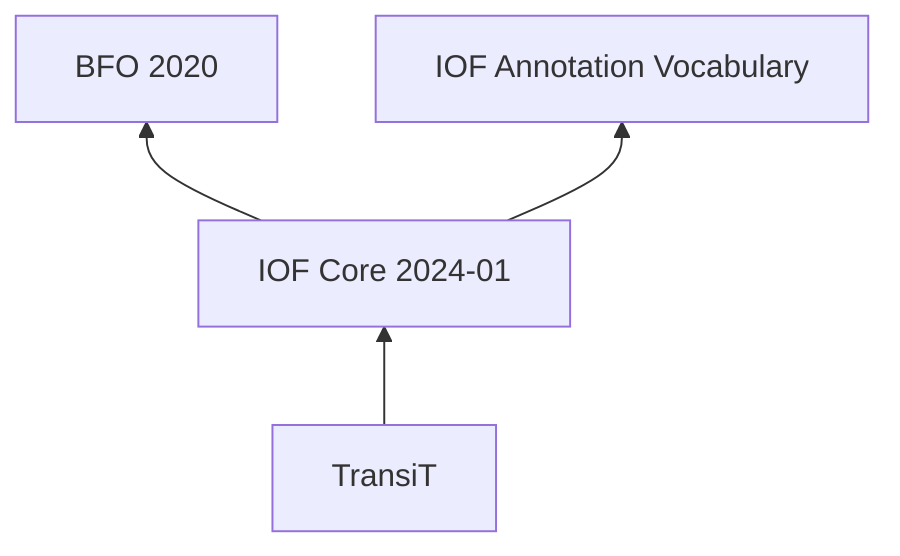

# TransiT Ontology

An OWL ontology for multimodal transport and logistics, developed at Cranfield University
with the Université de Technologie Tarbes Occitanie Pyrénées (UTTOP).

TransiT gives a shared vocabulary for the things that take part in a transport scenario:
journeys and travel legs, vehicles and the people who operate them, payloads, energy
(fuel and electricity) and charging, and the greenhouse-gas emissions that result. The
goal is a consistent semantic model that downstream analysis and optimisation tools can
build on, for example to compute the carbon footprint of a journey from fuel consumption
and vehicle design data.

The ontology is built on the **Basic Formal Ontology (BFO 2020)** as top-level ontology
and the **Industrial Ontologies Foundry Core (IOF Core, 2024-01)** as mid-level ontology.
Fourteen transport classes (vehicle, journey, movement, location and their specialisations)
were adapted from the UK Government **Information Exchange Standard 4 (IES4)**, but they are
TransiT's own terms. IES4 is a 4D ontology whose semantics differ from BFO, so it is not
imported; see [Provenance from IES4](#provenance-from-ies4).

| | |
|---|---|
| Ontology IRI | `https://www.cranfield.ac.uk/transit/202501` |
| Default prefix | `transit:` = `https://www.cranfield.ac.uk/transit/202501#` |
| Format | Turtle ([ontology/transit.ttl](ontology/transit.ttl)) |
| Size | 140 classes, 27 object properties, 12 data properties |
| Licence | MIT (see [LICENSE](LICENSE)) |

## Repository layout

```
.
├── ontology/
│   ├── transit.ttl                    The TransiT ontology (the main file)
│   └── catalog-v001.xml               Protégé / OWL API catalog mapping imports to local copies
├── imports/
│   ├── bfo.owl                        BFO 2020 (top-level ontology)
│   ├── iof-core.rdf                   IOF Core 2024-01 (mid-level ontology)
│   └── iof-annotation-vocabulary.rdf  IOF Annotation Vocabulary (imported by IOF Core)
├── docs/
│   ├── figures/                       Class hierarchy and scenario diagrams (see below)
│   └── owldoc-html-export-2025-03-24.zip   Generated HTML documentation (OWLDoc export)
├── LICENSE
└── README.md
```

The files under `imports/` are unmodified copies of third-party ontologies, kept here so the
ontology can be loaded offline and so that everyone works against the same versions.

## Import chain



TransiT imports IOF Core directly. IOF Core in turn imports BFO and the IOF Annotation
Vocabulary, so all four files are needed for a full load with reasoning.

## Provenance from IES4

Earlier versions imported IES4 and re-parented its classes under BFO and IOF. That mixed two
incompatible views of time: in IES4 a vehicle or a location is a 4D space-time extent with
temporal parts, whereas in BFO it is a continuant that is wholly present at each instant.
It also asserted axioms under the IES4 namespace that IES4 itself does not make.

TransiT therefore defines these classes itself: `Device`, `Vehicle`, `RoadVehicle`,
`Aircraft`, `Ship`, `Location`, `Airport`, `Movement`, `Journey`, `Transit`, `Flight`,
`Sailing`, `CarTravel` and `TrainTravel`. Each carries an `iof-av:adaptedFrom` annotation
and an `rdfs:seeAlso` link to the IES4 IRI it was adapted from, so the origin stays
traceable, but no IES4 axioms are loaded. If data exchange with IES4 systems is ever
needed, add a separate alignment file using `skos:closeMatch` and keep it out of the
`owl:imports` closure.

## What the ontology covers

TransiT classes are placed under BFO or IOF Core parents. The main groups are:

- **Movement.** `Movement` is a planned process from one `Location` to another. A
  `Journey` is a movement made of two or more `TravelLegProcess` parts, and a `Transit`
  is a single transportation operated by one vehicle (`Flight`, `Sailing`, `CarTravel`,
  `TrainTravel`). TransiT adds `Correspondence` (a change between legs), `route`, and the
  properties `departsAtOrigin`, `endsAtDestination`, `operatedByVehicle`, `passesBy`
  and `hasPayLoad`.
- **Vehicles and locations.** `Vehicle` is a `Device` (an IOF assembly), specialised into
  `RoadVehicle`, `Aircraft` and `Ship`; `HumanDrivenVehicle` and `AutonomousVehicle`
  specialise `RoadVehicle`. `Location` is a BFO site. Stations and ports
  (`CorrespondencePort`, `Airport`, `HarborPort`, `LandStation`, `ChargingStation`,
  `FuelStation`, `ConsolidationStation`, `ServiceStation`) are its specialisations.
- **Energy.** `Energy` is an IOF material resource, specialised into `Fuel` and
  `Electricity`. `EnergyProcess` is a planned process covering generation, storage,
  transmission and charging. `EnergyCharger`, `ElectricityCharger` and `FuelAdder` are
  devices, with `DesignedChargerFunction` and charger design classes (current, tension,
  phase, pin, connector type, communication protocol). Properties: `usesEnergy`,
  `chargesEnergy`, `appliesEnergy`.
- **Emissions.** `Emission` and `GreenhouseGasEmission` (with `CarbonDioxideEmission` and
  `MethaneEmission`) are material entities produced by an `EmissionProcess`. Emission
  processes are split into Scope 1, Scope 2 and Scope 3 following the GHG Protocol, and
  `EmissionUnitProcess` is the smallest unit emitting a single gas. `GHG_source` and
  `GHG_sink` are the material entities that emit or capture gas, linked through
  `hasEmission`, `hasEmitter`, `hasSubstance` and `hasParticipantInEmission`.
  `CarbonFootprint`, `Waste` and `Byproduct` cover the remaining residuals.
- **Roles.** `DriverRole`, `PayloadRole`, `EnergyProviderRole`, `EnergyChargerRole` and
  other BFO roles describe how a person, vehicle or organisation takes part in a process.
- **Specifications and measurements.** `TransportDesignSpecification` (capacity, fuel,
  emission, power, speed, monetary cost) describes the design values of a vehicle or
  service. Measured values (`MeasuredCostValueExpression`, `Distance`, qualities) carry
  the observed values through IOF `ValueExpression`, with `hasNumericalValue` and
  `hasUnit`. Time stamps use `startsAtTimeInstance` and `endsAtTimeInstance`.
- **Orders and ownership.** `Order` is an IOF agreement with `OrderContent`; `owns` and
  `ownedBy` relate owners to artefacts; `EnergyProvider` is an IOF supplier.

## Figures

| Figure | Shows |
|---|---|
| [Class hierarchy](docs/figures/fig1-class-hierarchy.png) | How TransiT classes (blue) attach to BFO and IOF classes (orange): gas, GHG entities, residuals and energy under *material entity*; emission processes under *process*; journeys and travel legs under *planned process*. The diagrams predate the IES4 change and still show `ies:` prefixes on the movement and vehicle classes. |
| [Emission scene](docs/figures/fig2-emission-scene.png) | Scenario where the emission process and emitted amount are recorded directly: an emission process has an emitter (a GHG source playing an emission-source role) and an emission whose substance and value expression are given. |
| [Transport scene](docs/figures/fig3-transport-scene.png) | Scenario where the emission must be calculated: a journey with a travel leg, its vehicle, driver, payload, distance and fuel, and the fuel design specification. A query multiplies consumption by the design emission factor. |
| [Transport scene (corrected)](docs/figures/transport-scene-demo.png) | Revised version of the transport scene with the TransiT-specific properties highlighted. |
| [Demo graph](docs/figures/demo-graph.png) | Protégé OntoGraf view of the main classes and their links. |

## Using the ontology

### Protégé

Open `ontology/transit.ttl` in Protégé. The `catalog-v001.xml` file in the same folder
redirects the imports to the local copies in `ontology/` and `imports/`, so no network
access is needed. Run a reasoner (HermiT or Pellet) to see the inferred hierarchy.

### Python (rdflib)

```python
import rdflib

g = rdflib.Graph()
g.parse("ontology/transit.ttl", format="turtle")
g.parse("imports/iof-core.rdf", format="xml")
g.parse("imports/bfo.owl", format="xml")
g.parse("imports/iof-annotation-vocabulary.rdf", format="xml")

q = """
PREFIX transit: <https://www.cranfield.ac.uk/transit/202501#>
PREFIX rdfs: <http://www.w3.org/2000/01/rdf-schema#>
SELECT ?cls ?label WHERE {
  ?cls rdfs:subClassOf* transit:EmissionProcess ; rdfs:label ?label .
}"""
for row in g.query(q):
    print(row.cls, row.label)
```

### Documentation

`docs/owldoc-html-export-2025-03-24.zip` contains browsable HTML documentation of every
class and property, generated from Protégé on 24 March 2025. Unzip it and open
`index.html`.

## Related work

The `air-ontology` branch holds a separate **Air Domain Ontology** (254 classes) covering
airports, aircraft, flight operations, crew, ground handling and air cargo, with WIDOCO
documentation. It is developed alongside TransiT but is not imported by it.

## Authors

- Zhengyu Liu, Université de Technologie Tarbes Occitanie Pyrénées (UTTOP), creator
- Bernadin Namoano, Cranfield University, contributor

## Licence

TransiT is released under the MIT Licence. The bundled third-party ontologies keep their
own licences: BFO is CC BY 4.0, and IOF Core and the IOF Annotation Vocabulary are MIT.
The fourteen class definitions adapted from IES4 derive from material published under the
Open Government Licence v3.0.
