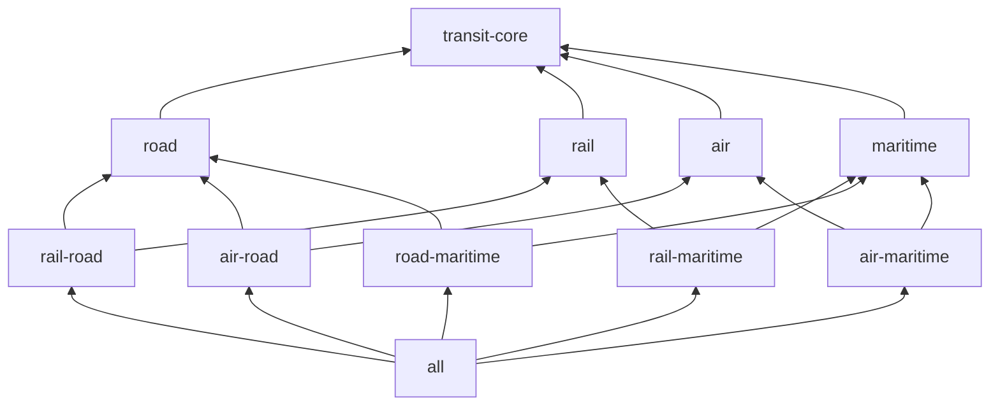

# TransiT Ontology

A modular OWL ontology for multimodal transport and logistics, developed at Cranfield
University with the Université de Technologie Tarbes Occitanie Pyrénées (UTTOP).

TransiT gives a shared vocabulary for the things that take part in a transport scenario:
journeys and travel legs, vehicles, payload and passengers, infrastructure and terminals,
energy (fuel and electricity) and charging, and the greenhouse-gas emissions that result.
The goal is a consistent semantic model that downstream analysis and optimisation tools can
build on, for example to compute the carbon footprint of an intermodal journey.

The ontology is built on the **Basic Formal Ontology (BFO 2020)** as top-level ontology
and the **Industrial Ontologies Foundry Core (IOF Core, 2024-01)** as mid-level ontology.
Fourteen transport classes were adapted from the UK Government **Information Exchange
Standard 4 (IES4)**; they are TransiT's own terms and IES4 is not imported (see
[Provenance from IES4](#provenance-from-ies4)).

| | |
|---|---|
| Version | 0.3.0 (2025-11) |
| Core IRI | `https://www.cranfield.ac.uk/transit/core` (prefix `transit:` = `.../core#`) |
| Format | Turtle, one file per module under [ontology/](ontology/) |
| Size | 148 classes across all modules, 104 of them in the core |
| Licence | MIT (see [LICENSE](LICENSE)) |

## Modules

The ontology is a mode-neutral **core** plus one module per transport **mode** and one
thin module per **intersection** of two modes. Each module imports what it needs, has its
own namespace, and can be loaded on its own.



| File | Namespace | Holds |
|---|---|---|
| [transit-core.ttl](ontology/transit-core.ttl) | `transit:` | movement, journey, travel leg, transshipment, vehicle, payload, infrastructure, energy, emissions, roles, specifications, the four transport-mode individuals |
| [transit-road.ttl](ontology/transit-road.ttl) | `road:` | RoadVehicle (Car, Bus, Truck, Van), Road, RoadTerminal, ServiceStation, RoadTravelLeg |
| [transit-rail.ttl](ontology/transit-rail.ttl) | `rail:` | RailVehicle (Train, Locomotive, Wagon), Railway, RailwayStation, RailTravelLeg |
| [transit-air.ttl](ontology/transit-air.ttl) | `air:` | Aircraft, Airway, Airport, Flight, SustainableAviationFuel |
| [transit-maritime.ttl](ontology/transit-maritime.ttl) | `maritime:` | Ship, Waterway, Seaport, Sailing |
| transit-rail-road.ttl, transit-air-road.ttl, transit-rail-maritime.ttl, transit-road-maritime.ttl, transit-air-maritime.ttl | one each | `<A><B>Terminal`, `<A><B>Journey`, `<A><B>Transshipment`, and disjointness of the two vehicle kinds |
| [transit-all.ttl](ontology/transit-all.ttl) | | imports everything; open this to load the whole ontology |

**How a mode module plugs in.** The core offers a handful of extension points: `Vehicle`,
`TravelLeg`, `Infrastructure`, `TransportWay`, `TransferNode`, `Terminal`, the
`TransportMode` individuals (`RoadMode`, `RailMode`, `AirMode`, `MaritimeMode`) and the
property `hasTransportMode`. A mode module subclasses those, defines its leg as a travel leg
operated by its vehicle kind, and tags every class with its mode. A travel leg has exactly
one mode; a terminal may have several, which is what makes an intermodal terminal
definable. The intersection modules are then a few axioms each: a rail-road terminal is a
terminal with both modes, a rail-road journey is a journey with a rail leg and a road leg,
and a rail-road transshipment is a transshipment between the two.

The reasoning behind every modelling choice and the full list of renames from version 0.2
are in [docs/design-decisions.md](docs/design-decisions.md).

## Repository layout

```
.
├── ontology/
│   ├── transit-core.ttl                 The mode-neutral core
│   ├── transit-{road,rail,air,maritime}.ttl
│   ├── transit-{rail-road,air-road,rail-maritime,road-maritime,air-maritime}.ttl
│   ├── transit-all.ttl                  Imports every module
│   └── catalog-v001.xml                 Protégé / OWL API catalog mapping every import to a local file
├── imports/
│   ├── bfo.owl                          BFO 2020 (top-level ontology)
│   ├── iof-core.rdf                     IOF Core 2024-01 (mid-level ontology)
│   └── iof-annotation-vocabulary.rdf    IOF Annotation Vocabulary (imported by IOF Core)
├── examples/
│   └── rail-road-journey.ttl            A container moved by train, transshipped, delivered by truck
├── tools/
│   └── validate.py                      Structural checks and HermiT reasoning over all modules
├── docs/
│   ├── design-decisions.md              Why the modules look the way they do; renames; open issues
│   └── figures/                         Diagrams from version 0.2 (class names predate the split)
├── LICENSE
└── README.md
```

The files under `imports/` are unmodified copies of third-party ontologies, kept so the
ontology loads offline and everyone works against the same versions.

## What the core covers

- **Movement.** `Movement` is an IOF planned process from one origin to one destination.
  A `Journey` is made of one or more `TravelLeg`s; a travel leg is operated by exactly one
  vehicle in exactly one transport mode. `IntermodalJourney` is a journey whose legs use
  different modes. `Transshipment` is the planned process at a `TransferNode` that moves
  payload from the vehicle of one leg to the vehicle of the next. Properties:
  `hasTravelLeg`, `operatedByVehicle`, `departsAtOrigin`, `endsAtDestination`, `passesBy`,
  `hasPayload`, `followsTravelLeg`, `precedesTravelLeg`.
- **Vehicles.** `Vehicle` is a `Device` (an IOF assembly). `HumanDrivenVehicle` and
  `AutonomousVehicle` are mode-neutral and disjoint. The kinds of vehicle live in the mode
  modules.
- **Payload and parties.** `Payload` is any material entity bearing a `PayloadRole`;
  `CargoUnit` covers containers, pallets and parcels. `Passenger` and `Driver` are persons
  with the matching role. `CarrierRole`, `ShipperRole` and `ConsigneeRole` identify the
  parties to a transport, with `Carrier`, `Shipper` and `Consignee` as defined classes.
- **Infrastructure.** `Infrastructure` is a built material entity located at some
  `Location` (a BFO site). `TransportWay` is the path vehicles move on, `TransferNode` is
  where legs start, end or connect, `Terminal` is a transfer node with facilities, and
  `EnergySupplyStation` (charging and fuel stations) supplies vehicles with energy.
- **Plans.** `Route` is an IOF plan specification that prescribes a journey, made of
  `RouteSegment`s. `Schedule` prescribes the planned times of movements.
- **Energy.** `Energy` is an IOF material resource specialised into `Fuel` and
  `Electricity`. `EnergyProcess` covers generation, storage, transmission and charging.
  `EnergyCharger`, `ElectricityCharger`, `ElectricVehicleCharger` and `FuelDispenser` are
  devices with `DesignedChargerFunction`s. Properties: `usesEnergy`, `chargesEnergy`.
- **Emissions.** `Emission` is a material residual released by an `EmissionProcess`, an
  inherent (unplanned) process that accompanies a planned one. `GreenhouseGasEmission`,
  `CarbonDioxideEmission` and `MethaneEmission` are defined by the substance emitted.
  `EmissionUnitProcess` decomposes a process into single-gas, single-emitter units.
  `GHGSource` and `GHGSink` are material entities bearing the matching role. GHG Protocol
  scopes are not kinds of process: `EmissionScopeAssignment` assigns `Scope1`, `Scope2` or
  `Scope3` to an emission process for one reporting organisation. `CarbonFootprint` is a
  value expression.
- **Specifications and measurements.** `TransportDesignSpecification` (capacity, fuel,
  emission, power, speed, monetary cost) prescribes design values; measured values go
  through IOF `ValueExpression` with `hasNumericalValue` and `hasUnit`. Time stamps use
  `startsAtTimeInstance` and `endsAtTimeInstance`.

## Using the ontology

### Protégé

Open `ontology/transit-all.ttl` (or any single module) in Protégé. The `catalog-v001.xml`
file in the same folder maps every import, including BFO and IOF Core, to the local copies,
so no network access is needed. Run HermiT or Pellet to see the inferred hierarchy.

### Validation

```
python tools/validate.py                      # parse, references, labels, definitions, OWL 2 DL check
python tools/validate.py --reason             # + consistency and satisfiability with HermiT
python tools/validate.py --reason --example examples/rail-road-journey.ttl
```

The last form also classifies the individuals of the example. Reasoning needs Python with
`rdflib` and `owlready2`, and a Java runtime. The example asserts only that one leg is
operated by a train and the next by a truck; the reasoner then infers the rail leg, the
road leg, the rail-road terminal, the rail-road journey and the rail-road transshipment.

### Python (rdflib)

```python
import rdflib

g = rdflib.Graph()
for f in ["ontology/transit-core.ttl", "ontology/transit-rail.ttl", "ontology/transit-road.ttl",
          "ontology/transit-rail-road.ttl"]:
    g.parse(f, format="turtle")
for f in ["imports/iof-core.rdf", "imports/bfo.owl", "imports/iof-annotation-vocabulary.rdf"]:
    g.parse(f, format="xml")

q = """
PREFIX transit: <https://www.cranfield.ac.uk/transit/core#>
PREFIX rdfs: <http://www.w3.org/2000/01/rdf-schema#>
SELECT ?cls ?label WHERE { ?cls rdfs:subClassOf* transit:Infrastructure ; rdfs:label ?label . }"""
for row in g.query(q):
    print(row.cls, row.label)
```

## Figures

The diagrams in [docs/figures/](docs/figures/) were drawn for version 0.2 and still show
the earlier class names (for example `ies:Journey`, `transit:Correspondence`). They remain
useful for the intent of the emission scenes.

| Figure | Shows |
|---|---|
| [Class hierarchy](docs/figures/fig1-class-hierarchy.png) | How TransiT classes attach to BFO and IOF: gases, residuals and energy under *material entity*; emission processes under *process*; journeys and travel legs under *planned process*. |
| [Emission scene](docs/figures/fig2-emission-scene.png) | Scenario where the emission process and emitted amount are recorded directly. |
| [Transport scene](docs/figures/fig3-transport-scene.png) | Scenario where the emission must be calculated from a journey, its vehicle, fuel and the fuel design specification. |
| [Transport scene (corrected)](docs/figures/transport-scene-demo.png) | Revised transport scene with the TransiT-specific properties highlighted. |
| [Demo graph](docs/figures/demo-graph.png) | Protégé OntoGraf view of version 0.2. |

## Provenance from IES4

Earlier versions imported IES4 and re-parented its classes under BFO and IOF. That mixed two
incompatible views of time: in IES4 a vehicle or a location is a 4D space-time extent with
temporal parts, whereas in BFO it is a continuant wholly present at each instant. TransiT
therefore defines these classes itself (`Device`, `Vehicle`, `Location`, `Movement`,
`Journey`, `RoadVehicle`, `Aircraft`, `Ship`, `Airport`, `Flight`, `Sailing` and others),
each carrying an `iof-av:adaptedFrom` annotation and an `rdfs:seeAlso` link to the IES4
IRI it was adapted from. No IES4 axioms are loaded. If data exchange with IES4 systems is
ever needed, add a separate alignment file using `skos:closeMatch` and keep it out of the
`owl:imports` closure.

## Related work

The `air-ontology` branch holds a separate **Air Domain Ontology** (254 classes) with its
own upper level. It is a candidate for extending the air module once its top classes are
aligned with BFO, IOF Core and the TransiT core.

## Authors

- Zhengyu Liu, Université de Technologie Tarbes Occitanie Pyrénées (UTTOP), creator
- Bernadin Namoano, Cranfield University, contributor
- Navya Nayak, Cranfield University, contributor

## Licence

TransiT is released under the MIT Licence. The bundled third-party ontologies keep their
own licences: BFO is CC BY 4.0, and IOF Core and the IOF Annotation Vocabulary are MIT.
The class definitions adapted from IES4 derive from material published under the Open
Government Licence v3.0.
