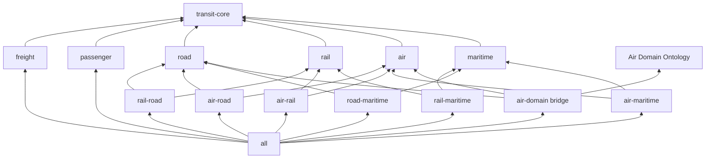

# TransiT Ontology

A modular OWL ontology for multimodal transport and logistics, developed at Cranfield
University with the Université de Technologie Tarbes Occitanie Pyrénées (UTTOP).

TransiT gives a shared vocabulary for the things that take part in a transport scenario:
journeys and travel legs, vehicle runs and what they carry, consignments and passengers,
infrastructure and terminals, services and timetables, energy carriers and charging,
schedules and disruptions, and the greenhouse-gas emissions that result. The goal is a
consistent semantic model that downstream analysis and optimisation tools can build on,
for example to compute the carbon footprint of an intermodal journey and allocate it to
the consignments or passengers carried.

The ontology is built on the **Basic Formal Ontology (BFO 2020)** as top-level ontology
and the **Industrial Ontologies Foundry Core (IOF Core, 2024-01)** as mid-level ontology.
Fourteen transport classes were adapted from the UK Government **Information Exchange
Standard 4 (IES4)**; they are TransiT's own terms and IES4 is not imported (see
[Provenance from IES4](#provenance-from-ies4)).

| | |
|---|---|
| Version | 0.5.0 (2025-11) |
| Core IRI | `https://www.cranfield.ac.uk/transit/core` (prefix `transit:` = `.../core#`) |
| Format | Turtle, one file per module under [ontology/](ontology/) |
| Size | 277 TransiT classes across all modules, 129 of them in the core, plus the 254-class Air Domain Ontology |
| Licence | MIT (see [LICENSE](LICENSE)) |

## Modules

The ontology is a mode-neutral **core**, one module per transport **mode**, one thin module
per **intersection** of two modes, two cross-cutting modules for **freight** and
**passengers** (what is moved, independent of how), and a **bridge** that hangs the
separately developed Air Domain Ontology under the core. Each module imports what it
needs, has its own namespace, and can be loaded on its own.



| File | Namespace | Holds |
|---|---|---|
| [transit-core.ttl](ontology/transit-core.ttl) | `transit:` | movement, journey, travel leg and vehicle run, transshipment, vehicle, payload, infrastructure and stops, transport services and operators, bookings, documents, tariffs, statuses, capacity and transport work, energy carriers and amounts, charger specifications, emissions, schedules, time slots and disruptions, roles, the transport-mode individuals |
| [transit-freight.ttl](ontology/transit-freight.ttl) | `freight:` | Consignment, ConsignmentLeg, FreightJourney, EmptyRun, kinds of goods (dangerous, perishable, temperature-controlled, bulk, containerised, palletised), cargo units (Container, SwapBody, Pallet, Parcel), Waybill and other documents, TransportOrder, delivery terms (Incoterms), FreightRate, LeadTime, forwarder and broker roles, handling processes from Pickup to Delivery, Warehouse, DistributionCentre, Depot, CrossDock, LoadingBay, DockAppointment, track-and-trace statuses |
| [transit-passenger.ttl](ontology/transit-passenger.ttl) | `pax:` | PassengerLeg, PassengerJourney, TripPurpose, PassengerGroup, Luggage, Line, Timetable, TimetabledRun, Headway, public and shared mobility services, TransportAuthority, Ticket, Reservation, Fare and FareClass, seated and standing capacity, PassengerCount, accessibility needs and features, ParkAndRide, Platform, Interchange, MissedConnection, Punctuality, statuses |
| [transit-road.ttl](ontology/transit-road.ttl) | `road:` | RoadVehicle (Car, Bus, Truck, Van, Motorcycle, Bicycle), Road, RoadTerminal, BusStation, ServiceStation, RoadTravelLeg |
| [transit-rail.ttl](ontology/transit-rail.ttl) | `rail:` | RailVehicle (Train, Locomotive, Wagon, Tram, Metro), Railway, RailwayStation, RailTravelLeg |
| [transit-air.ttl](ontology/transit-air.ttl) | `air:` | Aircraft (Aeroplane, Helicopter, UnmannedAircraft), Airway, Airport, Flight, SustainableAviationFuel |
| [transit-maritime.ttl](ontology/transit-maritime.ttl) | `maritime:` | Ship (Ferry, Barge, ContainerShip), Waterway, Seaport, Sailing |
| transit-rail-road, transit-air-road, transit-air-rail, transit-rail-maritime, transit-road-maritime, transit-air-maritime | one each | `<A><B>Terminal`, `<A><B>Journey`, `<A><B>Transshipment`, and disjointness of the two vehicle kinds |
| [air-domain.ttl](ontology/air-domain.ttl) | `ad:` | the Air Domain Ontology (airports, aircraft, airworthiness, flight operations, crew, cargo handling, regulation, safety), version 0.3.0, own IRI |
| [transit-air-domain.ttl](ontology/transit-air-domain.ttl) | | the bridge: subclass and sub-property axioms that place the air ontology's top level under BFO and IOF and its key classes under the TransiT core and air module |
| [transit-all.ttl](ontology/transit-all.ttl) | | imports everything; open this to load the whole ontology |

**Vehicle runs versus what they carry.** A `VehicleRun` is the vehicle's own movement: a
bus run on a line, a truck round, a flight. The legs of the passengers and consignments
aboard are separate `TravelLeg`s that are `carriedBy` the run, as occurrent parts of it.
One run carries many legs, which is what load factor, groupage and allocating a run's
emissions to what it carried require. The freight module's `ConsignmentLeg` and the
passenger module's `PassengerLeg` are the two kinds of carried leg; both are disjoint from
`VehicleRun`. For a carried leg to be classified by mode (for example as a `RoadTravelLeg`),
data must also state the vehicle on it, since propagating the vehicle from run to leg
through a property chain would put `operatedByVehicle` outside OWL 2 DL.

**How a mode module plugs in.** The core offers a handful of extension points: `Vehicle`,
`TravelLeg`, `Infrastructure`, `TransportWay`, `TransferNode`, `Terminal`, the
`TransportMode` individuals (`RoadMode`, `RailMode`, `AirMode`, `MaritimeMode`,
`WalkingMode`) and the property `hasTransportMode`. A mode module subclasses those, defines
its leg as a travel leg operated by its vehicle kind, and tags every class with its mode. A
travel leg has exactly one mode; a terminal may have several, which is what makes an
intermodal terminal definable. The intersection modules are then a few axioms each: a
rail-road terminal is a terminal with both modes, a rail-road journey is a journey with a
rail leg and a road leg, and a rail-road transshipment is a transshipment between the two.

The reasoning behind every modelling choice, the renames from earlier versions, the
assessment of the Air Domain Ontology and the open issues are in
[docs/design-decisions.md](docs/design-decisions.md).

## Repository layout

```
.
├── ontology/
│   ├── transit-core.ttl                 The mode-neutral core
│   ├── transit-{road,rail,air,maritime}.ttl
│   ├── transit-{rail-road,air-road,air-rail,rail-maritime,road-maritime,air-maritime}.ttl
│   ├── transit-freight.ttl              What is moved: consignments, documents, handling, freight nodes
│   ├── transit-passenger.ttl            Who is moved: passenger journeys, lines, tickets, accessibility
│   ├── air-domain.ttl                   Air Domain Ontology (own IRI)
│   ├── transit-air-domain.ttl           Bridge from the Air Domain Ontology to TransiT
│   ├── transit-all.ttl                  Imports every module
│   ├── catalog-v001.xml                 Protégé / OWL API catalog mapping every import to a local file
│   └── alignments/
│       └── transit-ies4-alignment.ttl   skos:closeMatch links to IES4; never imported
├── imports/
│   ├── bfo.owl                          BFO 2020 (top-level ontology)
│   ├── iof-core.rdf                     IOF Core 2024-01 (mid-level ontology)
│   └── iof-annotation-vocabulary.rdf    IOF Annotation Vocabulary (imported by IOF Core)
├── examples/
│   ├── rail-road-journey.ttl            A container moved by train, transshipped, delivered by truck
│   ├── freight-consignments.ttl         Two consignments on one truck run, documents, handling, an empty return
│   ├── passenger-commute.ttl            A commute by bus and train with an interchange, line, fare and ticket
│   └── air-domain-flight.ttl            A flight described in Air Domain Ontology terms only
├── tools/
│   └── validate.py                      Structural checks and HermiT reasoning over all modules
├── docs/
│   ├── design-decisions.md              Why the modules look the way they do; renames; open issues
│   └── figures/                         Diagrams from version 0.2 (class names predate the split)
├── LICENSE
└── README.md
```

The files under `imports/` are unmodified copies of third-party ontologies, kept so the
ontology loads offline and everyone works against the same versions.

## What the core covers

- **Movement.** `Movement` is an IOF planned process from one origin to one destination.
  A `Journey` is made of one or more `TravelLeg`s; a travel leg is in exactly one transport
  mode and operated by at most one vehicle (`PedestrianLeg` has none). `IntermodalJourney`
  is a journey whose legs use different modes. `Transshipment` is the planned process at a
  `TransferNode` that moves payload from the vehicle of one leg to the vehicle of the next.
  Properties: `hasTravelLeg`, `operatedByVehicle`, `departsAtOrigin`, `endsAtDestination`,
  `passesBy`, `hasPayload`, `followsTravelLeg`, `precedesTravelLeg`.
- **Vehicle runs, services and stops.** `VehicleRun` is a travel leg that is one vehicle's
  movement and `carries` the legs of what is aboard. A run `realisesService` a
  `TransportService`, the operator's offering (a line, a freight service), which is
  `offeredBy` a `TransportOperator`. Runs call at `Stop`s; a `StopCall` is the dwell at
  one stop with arrival and departure times. `Occupancy`, `LoadFactor` and
  `TransportWork` (tonne- or passenger-kilometres) are measured on runs and movements.
- **Bookings, documents, prices and status.** `Booking` reserves capacity on a service or
  run; `TransportDocument` (tickets, waybills, proofs of delivery) `documents` a movement,
  payload or booking; `Tariff` prices a service in a `MonetaryAmount`; `TransportStatus`
  values give the track-and-trace state of a movement or payload.
- **Plans and disruptions.** `Route` is an IOF plan specification that prescribes a journey,
  made of `RouteSegment`s. `Schedule` prescribes movements with `plannedStartTime` and
  `plannedEndTime`; actual times are on the movement. `TimeSlot` is a schedule for one
  stop call (a dock appointment, an airport slot). `Disruption`, `Delay`, `Incident` and
  `Cancellation` are inherent processes that `disrupt` a movement.
- **Vehicles.** `Vehicle` is a `Device` (an IOF assembly) that applies some energy carrier.
  `HumanDrivenVehicle` and `AutonomousVehicle` are mode-neutral and disjoint. The kinds of
  vehicle live in the mode modules.
- **Payload and parties.** `Payload` is any material entity bearing a `PayloadRole`;
  `CargoUnit` covers containers, pallets and parcels. `Passenger` and `Driver` are persons
  with the matching role. `CarrierRole`, `ShipperRole` and `ConsigneeRole` identify the
  parties to a transport, with `Carrier`, `Shipper` and `Consignee` as defined classes.
- **Infrastructure.** `Infrastructure` is a built material entity located at some
  `Location` (a BFO site). `TransportWay` is the path vehicles move on, `TransferNode` is
  where legs start, end or connect, `Terminal` is a transfer node with facilities, and
  `EnergySupplyStation` (charging and fuel stations) supplies vehicles with energy.
- **Energy.** `EnergyCarrier` is an IOF material resource: `Fuel` (with `Hydrogen`) and
  `Electricity`, which are disjoint. The quantity of energy is a separate `EnergyAmount`
  value expression with a numerical value and a QUDT unit, attached with `hasEnergyAmount`.
  `EnergyProcess` covers generation, storage, transmission and charging. `EnergyCharger`,
  `ElectricityCharger`, `ElectricVehicleCharger` and `FuelDispenser` are devices prescribed
  by `ChargerDesignSpecification`s (current, voltage, power, frequency, phase, connector,
  communication protocol).
- **Units.** `hasMeasurementUnit` links any value expression to a QUDT unit individual
  such as `unit:KiloW-HR`. The class `qudt:Unit` is declared locally so QUDT does not have
  to be imported. The string property `hasUnit` is deprecated.
- **Emissions.** `Emission` is a material residual released by an `EmissionProcess`, an
  inherent process that accompanies a planned one. `GreenhouseGasEmission`,
  `CarbonDioxideEmission` and `MethaneEmission` are defined by the substance emitted.
  `GHGSource` and `GHGSink` are material entities bearing the matching role. GHG Protocol
  scopes are not kinds of process: `EmissionScopeAssignment` assigns `Scope1`, `Scope2` or
  `Scope3` to an emission process for one reporting organisation. `CarbonFootprint` is a
  value expression.
- **Specifications and measurements.** `TransportDesignSpecification` (capacity, fuel,
  emission, power, speed, monetary cost) prescribes design values; measured values go
  through IOF `ValueExpression` with `hasNumericalValue` and `hasMeasurementUnit`. Time
  stamps use `startsAtTimeInstance` and `endsAtTimeInstance`.

## Using the ontology

### Protégé

Open `ontology/transit-all.ttl` (or any single module) in Protégé. The `catalog-v001.xml`
file in the same folder maps every import, including BFO, IOF Core and the Air Domain
Ontology, to the local copies, so no network access is needed. Run HermiT or Pellet to see
the inferred hierarchy.

### Validation

```
python tools/validate.py                      # parse, references, labels, definitions, OWL 2 DL check
python tools/validate.py --reason             # + consistency and satisfiability with HermiT
python tools/validate.py --reason --example examples/rail-road-journey.ttl
python tools/validate.py --reason --example examples/freight-consignments.ttl
python tools/validate.py --reason --example examples/passenger-commute.ttl
python tools/validate.py --reason --example examples/air-domain-flight.ttl
```

The example forms also classify the individuals of the example. Reasoning needs Python
with `rdflib` and `owlready2`, and a Java runtime. The rail-road example asserts only that
one leg is operated by a train and the next by a truck; the reasoner infers the rail leg,
the road leg, the rail-road terminal, the rail-road journey and the rail-road
transshipment. The air-domain example uses Air Domain Ontology terms only; through the
bridge the reasoner infers that the flight is a TransiT travel leg, the airports are
terminals, the aircraft is a vehicle, the pallet is payload and the airline is a carrier.

### Python (rdflib)

```python
import rdflib

g = rdflib.Graph()
for f in ["ontology/transit-core.ttl", "ontology/transit-rail.ttl", "ontology/transit-road.ttl",
          "ontology/transit-rail-road.ttl"]:
    g.parse(f, format="turtle")
for f in ["imports/iof-core.rdf", "imports/bfo.owl", "imports/iof-annotation-vocabulary.rdf"]:
    g.parse(f, format="xml")

q = """
PREFIX transit: <https://www.cranfield.ac.uk/transit/core#>
PREFIX rdfs: <http://www.w3.org/2000/01/rdf-schema#>
SELECT ?cls ?label WHERE { ?cls rdfs:subClassOf* transit:Infrastructure ; rdfs:label ?label . }"""
for row in g.query(q):
    print(row.cls, row.label)
```

## Air Domain Ontology

[ontology/air-domain.ttl](ontology/air-domain.ttl) is the Air Domain Ontology developed at
Cranfield: 254 classes covering passenger and cargo operations, airports, aircraft and
airworthiness, flight operations and crew, air traffic management, ground handling,
regulation, safety and environmental sustainability. It has its own pragmatic top level
and its own IRI, and remains usable on its own. Version 0.3.0 fixes four misfiled classes
and asserts `LeasedAircraft` under `Aircraft`; everything else is as the authors wrote it.

The bridge [ontology/transit-air-domain.ttl](ontology/transit-air-domain.ttl) maps its nine
top-level classes to BFO and IOF, its key classes to the TransiT core and air module, and
nine of its properties to TransiT properties. The whole closure is consistent under HermiT.
Three things are deliberately not aligned, and the reasons are in the bridge header and in
the design notes.

## Figures

The diagrams in [docs/figures/](docs/figures/) were drawn for version 0.2 and still show
the earlier class names (for example `ies:Journey`, `transit:Correspondence`). They remain
useful for the intent of the emission scenes.

| Figure | Shows |
|---|---|
| [Class hierarchy](docs/figures/fig1-class-hierarchy.png) | How TransiT classes attach to BFO and IOF: gases, residuals and energy under *material entity*; emission processes under *process*; journeys and travel legs under *planned process*. |
| [Emission scene](docs/figures/fig2-emission-scene.png) | Scenario where the emission process and emitted amount are recorded directly. |
| [Transport scene](docs/figures/fig3-transport-scene.png) | Scenario where the emission must be calculated from a journey, its vehicle, fuel and the fuel design specification. |
| [Transport scene (corrected)](docs/figures/transport-scene-demo.png) | Revised transport scene with the TransiT-specific properties highlighted. |
| [Demo graph](docs/figures/demo-graph.png) | Protégé OntoGraf view of version 0.2. |

## Provenance from IES4

Earlier versions imported IES4 and re-parented its classes under BFO and IOF. That mixed two
incompatible views of time: in IES4 a vehicle or a location is a 4D space-time extent with
temporal parts, whereas in BFO it is a continuant wholly present at each instant. TransiT
therefore defines these classes itself (`Device`, `Vehicle`, `Location`, `Movement`,
`Journey`, `RoadVehicle`, `Aircraft`, `Ship`, `Airport`, `Flight`, `Sailing` and others),
each carrying an `iof-av:adaptedFrom` annotation and an `rdfs:seeAlso` link to the IES4
IRI it was adapted from. No IES4 axioms are loaded. The alignment file
[ontology/alignments/transit-ies4-alignment.ttl](ontology/alignments/transit-ies4-alignment.ttl)
records the correspondences as `skos:closeMatch` for data exchange; it is never imported.

## Authors

- Zhengyu Liu, Université de Technologie Tarbes Occitanie Pyrénées (UTTOP), creator
- Bernadin Namoano, Cranfield University, contributor
- Navya Nayak, Cranfield University, contributor

## Licence

TransiT is released under the MIT Licence. The bundled third-party ontologies keep their
own licences: BFO is CC BY 4.0, and IOF Core and the IOF Annotation Vocabulary are MIT.
The class definitions adapted from IES4 derive from material published under the Open
Government Licence v3.0.
